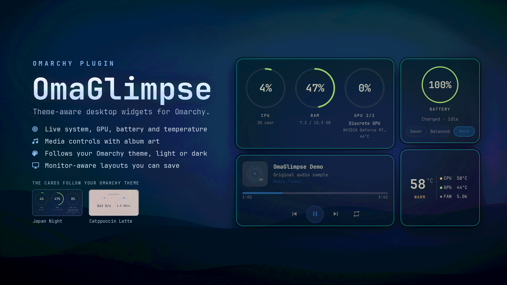
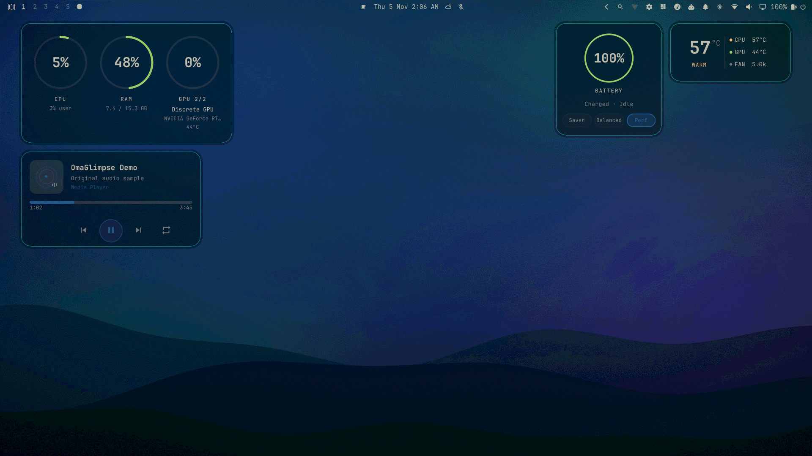
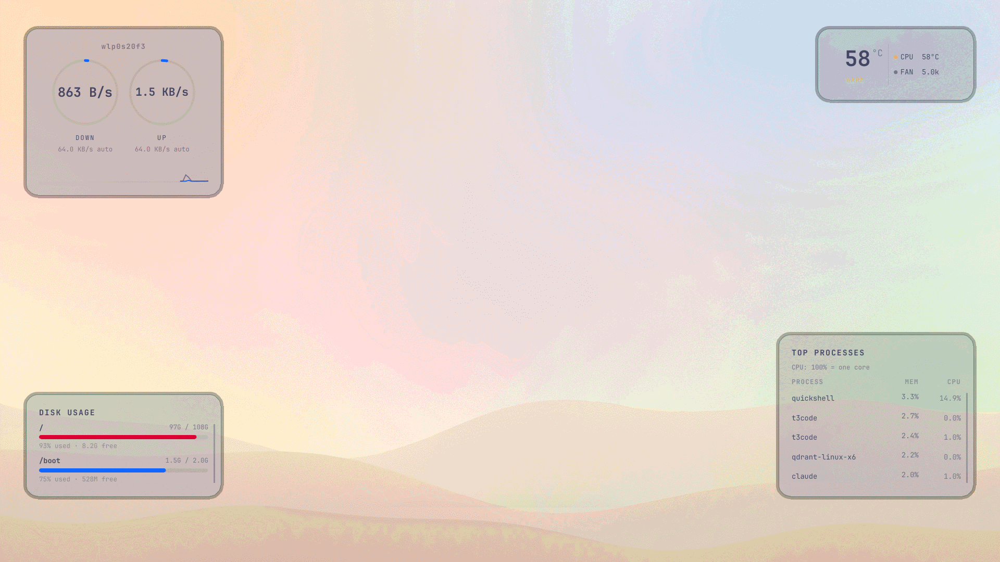
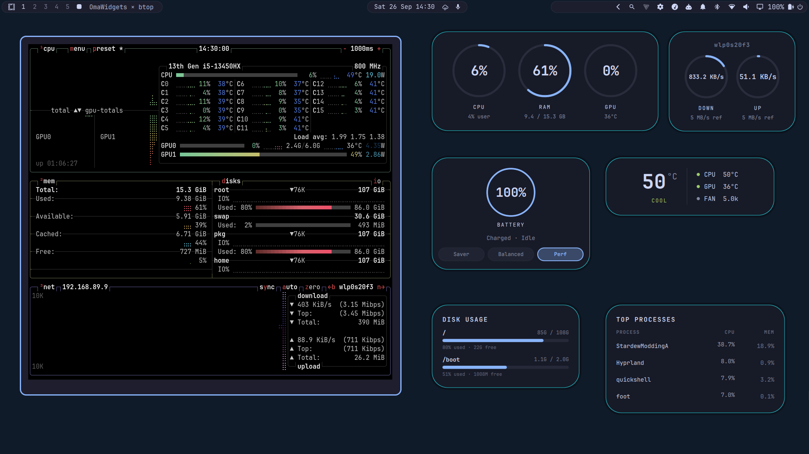
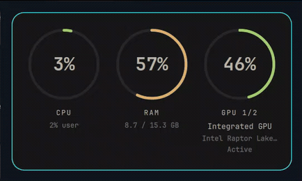

<h1 align="center">OmaGlimpse</h1>

<p align="center">
  Floating, theme-aware desktop cards for <a href="https://omarchy.org">Omarchy</a>:<br>
  system stats, battery, media, processes, disks, network and temperatures at a glance.
</p>

<p align="center">
  
  
  
  
</p>

<p align="center">
  
</p>

<p align="center"><em>System Monitor, Media, Battery and Temperature in the Japan Night community theme. The media card is playing an original demo audio sample.</em></p>

## Highlights

- **Follows your Omarchy theme.** Colors update with the theme, or switch on custom colors, opacity and blur in settings.
- **Seven cards.** System monitor, battery and power, media, top processes, network, disks and temperatures. Four are on by default.
- **Multi-GPU aware.** One GPU gauge cycles through every detected GPU by scroll, drag, arrow keys or hover arrows. Intel, NVIDIA and AMD readings are supported.
- **Monitor-aware layouts.** Each monitor setup remembers its own layout. Save named layouts such as Work or Gaming.
- **Sizes that adapt.** Width and height sliders each have an **Auto** reset. Short cards switch to compact layouts instead of stretching.
- **Light on resources.** Collectors pause while the session is locked, the display is off or the overlay is hidden, and slow down in power-saver mode.
- **Safe by design.** Remote album art is size-limited and sanitized, and settings paste is bounded and never watches the clipboard. The plugin installs no packages and asks for no elevated privileges.

## The cards

| Card | Shows | Options in settings |
| --- | --- | --- |
| **System Monitor** | CPU and memory gauges, plus one GPU gauge that switches between detected GPUs. | Show or hide each gauge, choose the GPU, name each detected GPU, gauge size, update interval. |
| **Battery & Power** | Charge and battery energy flow (UPower), plus power-profile buttons when the system supports them. | Show power (W), show power profiles, gauge size. |
| **Media Player** | Track details, album art, timeline and playback controls for an MPRIS player. | Show album art, show playback controls. |
| **Top Processes** | Processes ranked by recent CPU or memory use. | Process count, sort by CPU or memory, update interval. |
| **Network Speed** | Live download and upload rates and a short traffic history. Off by default. | Interface (automatic or chosen), gauge scale (automatic or fixed MB/s), history graph on or off. |
| **Disk Usage** | Usage of mounted filesystems; pseudo-filesystems are filtered out. Off by default. | Update interval. |
| **Temperature** | CPU and GPU sensors and fan speed where available. Off by default. | CPU, GPU and fan toggles, Celsius or Fahrenheit. |

Every card can also be moved, resized, given an opacity and, optionally, set to **click-through** so it ignores mouse input.

## Screenshots

<table>
  <tr>
    <td align="center"><br><sub>Japan Night (dark)</sub></td>
    <td align="center"><br><sub>Catppuccin Latte (light)</sub></td>
  </tr>
</table>

<p align="center"><sub>Wallpapers in these screenshots are original artwork made for this repo (<code>assets/wallpapers/</code>).</sub></p>

<p align="center">
  <br>
  <em>OmaGlimpse and btop side by side for a visual comparison. This is not a performance benchmark.</em>
</p>

<p align="center">
  <br>
  <em>Five seconds of live desktop readings at normal speed. <a href="assets/gpu-live-preview.mp4">Watch the video</a> or the <a href="assets/omaglimpse-promo.mp4">full demo</a>.</em>
</p>

## Requirements

- Omarchy with the Quickshell-based `omarchy-shell` and its plugin commands.
- Standard Linux `/proc` and `/sys` interfaces, Python 3 for process snapshots, and `df`, `timeout` and a POSIX shell for disk and sensor readings.

Optional, for specific features:

| Feature | Needs |
| --- | --- |
| Battery status and energy flow | UPower |
| Media controls | An MPRIS-capable player |
| NVIDIA readings | `nvidia-smi` |
| Intel GPU usage | `intel_gpu_top` from `intel-gpu-tools`, with performance counters readable by your user |
| AMD GPU usage, VRAM, temperature | Readable `/sys` interfaces exposed by the driver |
| Better GPU names | `lspci` |
| Remote album covers | curl 8.4+ for size- and time-limited HTTPS downloads. Local covers and the theme-matched fallback work without it. |
| Paste in settings | `wl-clipboard`. Typing works without it. |
| Power profiles | `powerprofilesctl` and a supported driver. The buttons call Omarchy's `omarchy-powerprofiles-set`. |

Unavailable readings are hidden or shown as unavailable, and detected GPUs stay selectable when readings are missing or the device is sleeping.

## Install

```bash
omarchy plugin add https://github.com/TammyX44/OmaGlimpse.git --enable
```

The plugin adds a settings button to the Omarchy bar (right section by default). If you installed an earlier development build, remove or disable it first to avoid duplicate cards. Your saved settings live in a separate JSON file and are not overwritten.

### Update

```bash
omarchy plugin update io.github.tammyx44.omaglimpse
```

If the shell still shows the previous widget afterwards, run `omarchy restart shell`.

### Uninstall

Run `omarchy plugin remove` and select `io.github.tammyx44.omaglimpse` from the list. Omarchy disables the plugin and removes its folder. Your preferences in `~/.config/omarchy/tammy-widgets.json` are left in place; delete that file yourself if you no longer want them.

## Configuration

Click the OmaGlimpse button in the bar, or right-click any card and choose **Open full settings**. The panel lets you enable cards, set appearance and sizes, pick a position preset (left, right, top, bottom, center or spread), and enter edit mode to drag cards.

**Config file.** Settings are saved to `~/.config/omarchy/tammy-widgets.json`. The filename is kept from the earlier OmaWidgets name so existing preferences carry over. The file is created on first save, the plugin reloads it when it changes, and you can edit it by hand. If it contains invalid JSON, fix it or use **Reset to defaults** in the panel, which asks for confirmation. Writes are atomic and debounced, but unsaved changes are not guaranteed to survive a power failure or a forced kill.

<details>
<summary><strong>Layout editor and monitor setups</strong></summary>

&nbsp;

Turn on edit mode to see alignment guides while dragging. Grid snapping and card-edge snapping are configured separately under **Layout Editor**, and guides use **Card Spacing** for consistent gaps. **Undo last layout change** restores positions, sizes, enabled cards and spacing. Theme and data-source preferences are left alone.

Save a named arrangement such as Work or Gaming and load it later. Replacing or deleting a named layout needs a second click.

**Widget display** chooses the monitor that holds the cards. Each monitor arrangement, resolution and scale remembers its own layout, and reconnecting a known setup restores it. A smaller setup fits manual positions to its usable area without changing what was saved for the larger one. Cards that cannot fit still raise a layout warning. The cards occupy one display at a time.

</details>

<details>
<summary><strong>Card sizing: Auto vs manual</strong></summary>

&nbsp;

Each card's expanded settings have independent **Card Width** and **Card Height** sliders, each with an **Auto** reset. Height defaults to Auto, so existing layouts are unchanged.

Shorter cards use compact layouts: artwork and gauges stay proportional, media controls reflow, battery details sit beside the gauge, and network rates switch to a numeric view while the optional history graph stays visible. Process and disk lists scroll beneath fixed headings instead of growing the card. Only a small readability minimum is enforced (80 to 110 px for the default cards, depending on content), and text and controls are never stretched. Height changes are part of Undo, named layouts and monitor layouts. Older saved layouts restore Auto height.

</details>

<details>
<summary><strong>Sampling and power behavior</strong></summary>

&nbsp;

All card collectors pause while the session is locked, the selected display is powered off, or the overlay is hidden. In power-saver mode, sampling intervals become three times longer, with an immediate refresh on resume. UPower and MPRIS keep their normal event-driven updates. Lock and display state are checked by bounded IPC calls every two seconds, and a failed check keeps the last known state. This reduces polling. It is not a claim of zero CPU use.

- **Top Processes** measures changes in process CPU ticks between snapshots. 100% is one fully busy logical CPU, so multithreaded processes can exceed 100%. A first sample or a reused PID shows a dash until there is a valid baseline. Memory is available immediately.
- **Power profiles** update promptly from service notifications. Hardware confirmation still follows a requested change, and a ten-second firmware check (thirty seconds in saver mode) catches hotkeys that bypass the service. Pending and failed requests are shown.
- **Network Speed** uses **Automatic** scaling, which rises promptly and falls gradually, or a fixed **MB/s** reference. Pauses, interface changes and counter resets rebaseline the rate instead of producing a false spike.

</details>

<details>
<summary><strong>Multiple GPUs</strong></summary>

&nbsp;

Scroll over the GPU gauge, drag horizontally, or use the arrows that appear on hover. With the gauge focused, the arrow keys work too. The gauge and labels slide together so the card size stays fixed, and fast scrolling keeps one pending step instead of restarting the transition. Scrolling and dragging are disabled in edit mode and when the card is click-through.

Default titles are **Integrated GPU** and **Discrete GPU** when the model is recognizable, with the hardware name underneath. Uncertain devices get a vendor title such as **Intel GPU** or **AMD GPU**. Under **System Monitor** settings you can choose the selected GPU and give each device a custom name. Clearing a name restores the default. Selection and names are saved by PCI identity, not by a changing DRM card number, and if the selected GPU disappears the first available device is shown until it returns.

The Temperature card uses the selected GPU's temperature. Both cards share one GPU collector at the shortest refresh interval their enabled readings need. Hardware discovery runs every 30 seconds. AMD sensors use direct file reads, NVIDIA queries are bounded and back off after failure, and Intel's optional tool streams samples. A sleeping GPU shows "Sleeping", and missing usage shows "Unavailable" with a dash instead of a false 0%.

Intel usage needs both `intel_gpu_top` and permission to read hardware performance counters. If the tool reports "Permission denied", installing it is not enough. See the [Linux performance-counter access documentation](https://www.kernel.org/doc/html/latest/admin-guide/perf-security.html) for `CAP_PERFMON` setup. OmaGlimpse runs the collector as your normal user and never changes permissions.

On first launch with older saved settings, the plugin clears space below the taller GPU card. Only manually positioned cards that are affected move down (horizontal positions stay), already-clear layouts stay put, and if there is not enough room the cards stay in place and the overlap warning remains available. This runs once.

</details>

<details>
<summary><strong>Media card details</strong></summary>

&nbsp;

The media card works with apps that expose MPRIS, including supported browsers and audio and video players. It reserves its playback height while idle, so starting a player never expands it over neighboring cards. If an older saved layout already overlaps, reposition the cards or apply a position preset once.

The timeline keeps its place even when a player omits timing data: unavailable times show `--:--`, and seeking is disabled until both duration and position are valid. Playback controls stay available for playing or paused sources without track metadata, subject to the player's capabilities and the **Show playback controls** setting. Switching players or tracks cancels an unfinished seek.

The repeat button cycles **Off, Playlist, Track** for the displayed player and is disabled when the player does not support repeat control. Progress reads fresh position and duration every two seconds while visible, with rate-aware interpolation in between. This catches same-track repeats and late duration changes even when a player sends no change signals. Reads use Python 3 and systemd's `busctl`. A percentage seek bar needs a real duration. Some BloomeeTunes Linux builds publish a stale position and omit `mpris:length`, so their MPRIS integration must be fixed before external widgets can seek reliably.

Remote HTTPS artwork is bounded and sanitized before Qt reads it. Only validated static PNG data is published, with compressed text, color profiles, EXIF and animation chunks stripped. Other remote image formats show the placeholder, and local artwork files still work. This addresses the PNG metadata expansion finding in [marketplace issue #11152](https://github.com/omacom/omarchy-plugin-marketplace/issues/11152). Publishing still requires validation of the final exact commit.

</details>

<details>
<summary><strong>Settings clipboard handling</strong></summary>

&nbsp;

The settings window exists only while open. Its native text renderers stay read-only even during keyboard editing, which stops Qt's automatic clipboard-availability handler from reading foreign clipboard offers. Explicit **Ctrl+V** or **Shift+Insert** runs an asynchronous helper with a 16 KiB input cap and one shared two-second deadline for MIME discovery and content. Oversized, slow, non-text and invalid UTF-8 offers are rejected, and closing or leaving the field cancels the request. No clipboard watcher runs in the background.

Fields keep cursor navigation, mouse selection, select-all, copy and cut, and bounded undo and redo. Direct key text and UTF-8 paste work. Native IME and preedit composition are not available through the read-only renderer. Paste errors are exposed through the field's accessibility description.

</details>

## Shell commands (IPC)

OmaGlimpse registers an IPC target named `io.github.tammyx44.omaglimpse`, so you can drive it from keybindings or scripts:

```bash
qs ipc --path /usr/share/omarchy/shell call io.github.tammyx44.omaglimpse openSettings
```

| Function | What it does |
| --- | --- |
| `openSettings` | Open the settings panel. |
| `openWidgetSettings <widgetId>` | Open settings focused on one card: `systemMonitor`, `battery`, `media`, `topProcesses`, `networkSpeed`, `diskUsage` or `temperature`. |
| `closeSettings` | Close the settings panel. |
| `toggleEdit` | Toggle layout edit mode. |
| `preset <name>` | Apply a position preset: `left`, `right`, `top`, `bottom`, `center` or `spread`. |
| `undo` | Undo the last layout change. |
| `rescan` | Reload the config file. |
| `status` | Print card positions, config and save state, GPU discovery and media state as JSON. |

If Omarchy is installed somewhere other than `/usr/share/omarchy/shell`, change the `--path` value to match.

## Project structure

```text
manifest.json         Omarchy plugin manifest (id, version, entry points)
Widgets.qml           Desktop overlay: layout, settings, config persistence, IPC
SettingsButton.qml    Bar button that opens settings
widgets/              The seven cards plus GPU and artwork parts
components/           Shared UI: gauges, toggles, dropdowns, context menu,
                      safe text field, sampling policy
settings/             Settings panel, layout editor and size controls
lib/                  Pure JavaScript: config, models, theme, design tokens,
                      sizing, layout profiles, sampling, GPU, network history
scripts/              Helper processes: process and media snapshots, album art
                      fetching, bounded clipboard paste, GPU discovery
tests/                Node, Python and QML checks, plus the collector benchmark
assets/, preview.png  Screenshots, GPU preview and demo video
docs/                 Project notes, such as the widget audit
```

## Development

CI runs the Node tests, validates `manifest.json` and runs the Python tests. The full local set:

```bash
node --test tests/*.test.cjs
python3 -m unittest discover -s tests -p 'test_*.py' -v
sh tests/run-gpu-qml-tests.sh
sh tests/sampling-run-qml-tests.sh
NETWORK_QML_TESTS=1 node --test tests/network-history.test.cjs
sh tests/run-layout-qml-tests.sh
sh tests/run-persistence-qml-tests.sh
sh tests/run-safe-textfield-qml-tests.sh
sh tests/run-sizing-qml-tests.sh
LIST_CARD_QML_TESTS=1 node --test tests/list-card-resizing.test.cjs
node --test tests/media-resizing.test.cjs
GAUGE_QML_TESTS=1 node --test tests/gauge-breakpoints.test.cjs
```

The QML checks need an installed Omarchy shell, Quickshell and QtTest. Set `OMARCHY_SHELL_DIR` if the shell is not at `/usr/share/omarchy/shell`. They use temporary settings and simulated Intel, NVIDIA and AMD telemetry, and they leave your desktop settings untouched.

> **The layout and persistence suites need a running Wayland session.** They load the real desktop types, open a temporary window and use an isolated settings file. The other QML suites run offscreen. Python collector runtime checks skip on systems without the required QML modules.

<details>
<summary><strong>Benchmark note</strong></summary>

&nbsp;

`node tests/benchmark-collectors.cjs` runs a short before/after collector workload check. It compares the working tree with `HEAD` by default (set `BENCH_BASE_REF` to compare against an earlier revision after committing). It runs all seven cards offscreen with simulated normal, saver and paused states, and reports CPU, main-process PSS and voluntary context switches. It changes no desktop preferences or power state.

The [local 3.2.0 results](tests/benchmark-results-2026-10-10.json) show lower CPU in the simulated paused state (8.2% to 2.2% of one core), similar memory and fewer voluntary context switches. Normal active CPU rose (10.28% to 13.0%) with the added functionality. Context switches are not kernel wakeup counts, and this short software-rendered run is not a whole-desktop or energy benchmark. It does not establish an overall CPU reduction or native desktop energy savings.

</details>

## Roadmap

Planned ideas include workspace-aware card visibility and further visual polish. These are proposals, not commitments or dates.

## Credits

Created by [TammyX44](https://github.com/TammyX44). Thanks to [peterxiemin](https://github.com/peterxiemin) for fixing the media card overlap when playback starts ([PR #1](https://github.com/TammyX44/OmaGlimpse/pull/1)).

## License

MIT. See [LICENSE](LICENSE).
