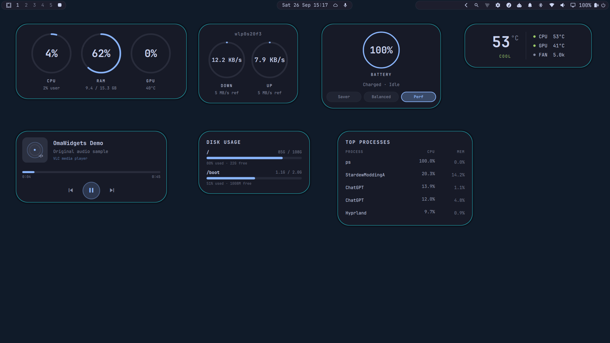
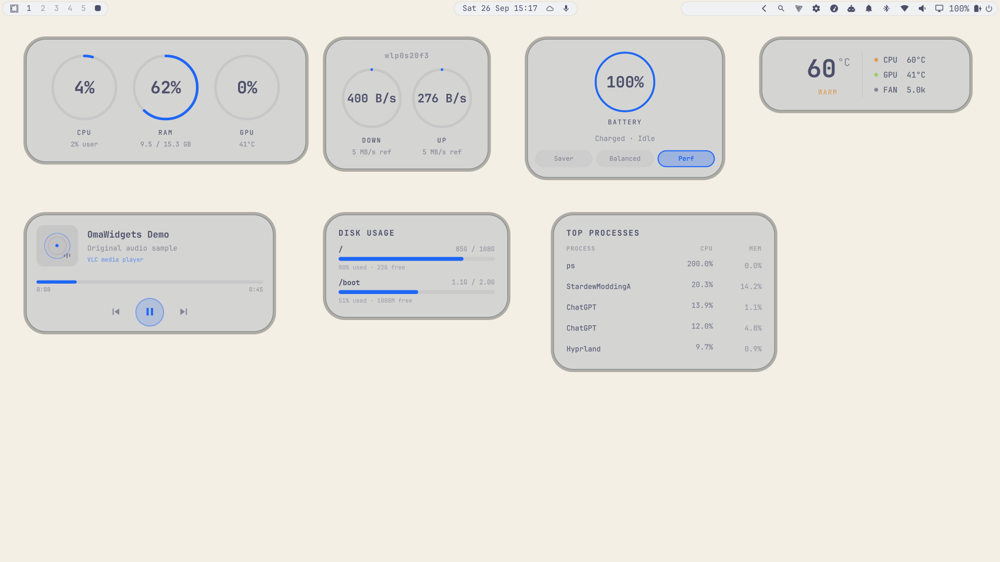
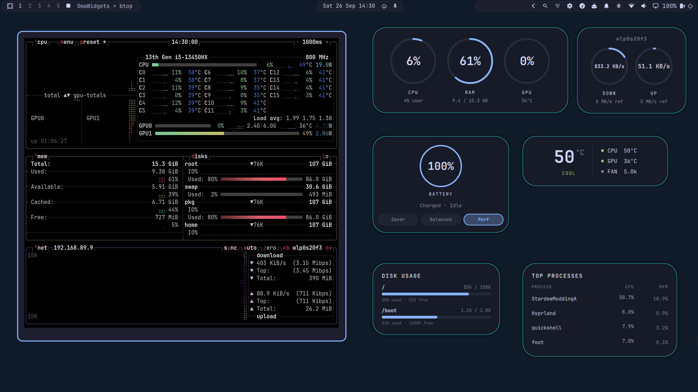
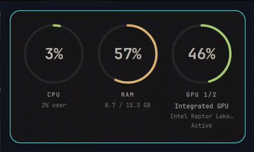

# OmaGlimpse

OmaGlimpse is a set of floating desktop cards for [Omarchy](https://omarchy.org). It puts system activity, battery status, media playback, and other live readings on the desktop, with colors that follow your Omarchy theme. Its Omarchy plugin manifest ID is `io.github.tammyx44.omaglimpse`.



*All seven cards on one desktop in Omarchy's Catppuccin theme. The media card is playing an original demo audio sample.*



*The same seven-card layout in a light Omarchy theme.*

## What it includes

- **System Monitor:** CPU and memory gauges, plus one GPU gauge that switches between detected GPUs with scrolling, horizontal dragging, or hover arrows. Device names and optional custom names identify the selected GPU.
- **Battery & Power:** charge and battery energy flow when UPower reports them; power profile controls when supported by the system.
- **Media Player:** track details and playback controls for an available MPRIS player.
- **Top Processes:** processes ranked by recent CPU or memory use, using interval readings rather than lifetime averages.
- **Network Speed:** live download and upload rates, adaptive or fixed gauge scaling, and a short traffic history for an automatically detected or selected interface.
- **Disk Usage:** usage of mounted filesystems.
- **Temperature:** available CPU and GPU sensor readings, with Celsius or Fahrenheit display.

The first four cards are enabled by default. Enable Network Speed, Disk Usage, and Temperature in settings when you want them. Cards support theme-following or custom colors, individual sizing and positioning, layout presets, and optional per-card click-through. The overlay blurs the desktop behind the cards when blur is enabled.



*OmaGlimpse and btop side by side for a visual comparison; the image is not a performance benchmark.*

[Watch the OmaGlimpse demo](assets/omaglimpse-promo.mp4)

## Repository layout

| Path | Purpose |
| --- | --- |
| `manifest.json`, `Widgets.qml` | Declare the Omarchy plugin and coordinate the desktop overlay, card layout, settings, and IPC. |
| `*Widget.qml`, `SystemMonitor.qml`, `Temperature.qml`, `TopProcesses.qml`, `NetworkSpeed.qml`, `DiskUsage.qml` | Render the seven live cards and read their data sources. |
| `SettingsPanel.qml`, `WidgetDropdown.qml`, `WidgetContextMenu.qml`, `SettingsButton.qml` | Provide the settings panel, per-card controls, context menu, and bar button. |
| `WidgetConfig.js`, `WidgetModel.js`, `WidgetTheme.js`, `CircularGauge.qml`, `CompactToggle.qml` | Validate preferences, parse readings, follow theme colors, and share UI controls. |
| `ArtworkPlaceholder.qml`, `fetch_album_art.py` | Draw a theme-matched media placeholder and safely fetch bounded remote cover images. |
| `SafeTextField.qml`, `bounded-clipboard.py` | Keep native clipboard probing disabled and handle explicit text pastes through a byte- and time-limited helper. |
| `SamplingPolicy.qml`, `SamplingModel.js` | Coordinate lock, display power and power-saver sampling across the cards. |
| `LayoutProfiles.js`, `WidgetLayout.js`, `LayoutEditorControls.qml` | Remember monitor and named layouts, snap cards, and provide the layout editor. |
| `WidgetSizing.js`, `WidgetSizeControls.qml` | Size cards without cropping their content and provide independent width/height controls with Auto resets. |
| `ProcessModel.js`, `process_snapshot.py`, `NetworkHistory.js` | Calculate interval process CPU readings and bounded network history and scaling. |
| `tests/`, `.github/workflows/` | Check widget behavior and manifest validity locally and in CI. |
| `assets/`, `preview.png` | Hold the approved screenshots, demo video, and marketplace preview. |

## Requirements

- Omarchy with the Quickshell-based `omarchy-shell` and its plugin commands.
- Standard Linux `/proc` and `/sys` interfaces, Python 3 for process snapshots, and system utilities (`df`, `timeout`, and a POSIX shell) for disk and sensor readings.
- Optional: UPower for battery status and energy flow; an MPRIS-capable player for media controls; `nvidia-smi` for NVIDIA readings; `intel_gpu_top` from `intel-gpu-tools` for Intel usage when performance counters are readable by the current user. AMD utilization, VRAM, and GPU temperatures use readable `/sys` interfaces where the driver exposes them. `lspci` improves detected GPU names.
- Optional: curl 8.4+ for size- and time-limited HTTPS album-cover downloads. Local covers and the theme-matched fallback work without it.
- Optional: `wl-clipboard` for explicit paste in settings. Typing works without it; paste failures retain the existing field value.
- Optional: `powerprofilesctl` and a supported power-profile driver for profile detection and switching. The profile buttons call Omarchy's `omarchy-powerprofiles-set` command, which also remembers the selection in the user's Omarchy state directory.

Unavailable hardware readings are hidden or shown as unavailable. Detected GPUs remain selectable when readings are missing or the device is sleeping. The plugin does not install extra packages, change performance-counter permissions, or request elevated privileges.

## Install

```bash
omarchy plugin add https://github.com/TammyX44/OmaGlimpse.git --enable
```

If you installed an earlier development build, remove or disable it before adding this release to avoid duplicate cards. Your saved widget settings remain in a separate JSON file.

The plugin adds a settings button to the Omarchy bar (right section by default).

## Uninstall

Run `omarchy plugin remove` and select the OmaGlimpse installation from the list. Omarchy disables and removes the installed plugin folder. Your separate `~/.config/omarchy/tammy-widgets.json` preferences remain untouched; delete that file manually only if you no longer want them.

## Configure

Click the bar settings button or right-click a card and choose **Open full settings**. Use the panel to enable cards, adjust appearance and card sizes, choose a layout preset, and enter edit mode to drag cards. Card settings include position, opacity, and update interval where applicable. Battery and media readings update through UPower and MPRIS rather than a configurable polling interval.

Settings are saved to `~/.config/omarchy/tammy-widgets.json`. This established filename is retained for compatibility with existing OmaWidgets installations, so existing preferences continue to work after upgrading to OmaGlimpse. You can also edit that JSON file directly; the plugin reloads it when it changes. The file is created when settings are first saved. If the file contains invalid JSON, correct it or use the settings panel's reset control.

The media card reserves its playback height while idle, so starting a player or receiving a track duration does not expand it over neighboring cards. If an older saved layout already overlaps, reposition the affected cards or apply a layout preset once.

The media card works with apps that expose MPRIS, including supported browsers and audio/video players. Its timeline stays in place even when the player omits timing data: unavailable times show `--:--`, and seeking is disabled until both duration and position are valid. Playback controls remain available for playing or paused sources without track metadata, subject to the player's capabilities and the **Show Controls** preference. Switching players or tracks cancels an unfinished seek rather than applying it to the new source.

The repeat button cycles **Off → Playlist → Track → Off** for the displayed player and is disabled when repeat control is unsupported. Progress reads fresh position and duration from the player every two seconds while visible, with rate-aware interpolation between reads. This catches same-track repeats and late duration changes even when a player omits change signals. Reads use Python 3 and systemd's `busctl`; initial read failures use native MPRIS timing, and later read failures stop extrapolating after the sampling window. A percentage seek bar still requires a real duration: some BloomeeTunes Linux builds publish a stale position and omit `mpris:length`, so their MPRIS integration must be corrected before external widgets can seek reliably.

Remote HTTPS artwork is bounded and sanitized before Qt reads it. Only validated static PNG data is published; compressed text, color profiles, EXIF and animation chunks are stripped. Other remote image formats show the placeholder. Local artwork files remain supported. This addresses the PNG metadata expansion finding in [marketplace issue #11152](https://github.com/omacom/omarchy-plugin-marketplace/issues/11152); publishing still requires validation of the final exact commit.

Installing the plugin does not overwrite existing preferences. Changes made in the settings panel save to the plugin's own JSON file, and resetting to defaults requires confirmation.

Settings are written atomically after a short debounce. Unchanged startup saves do not block later edits, and normal component shutdown flushes pending edits. This does not guarantee unsaved changes survive a power failure or a forced process kill.

### Settings clipboard handling

The settings window exists only while open. Its native text renderers remain read-only even during keyboard editing, preventing Qt's automatic clipboard-availability handler from reading foreign clipboard offers. Explicit **Ctrl+V** or **Shift+Insert** runs an asynchronous helper with a 16 KiB input cap and one shared two-second deadline for MIME discovery and content. Oversized, slow, non-text and invalid UTF-8 offers are rejected; closing or leaving the field cancels the request. No clipboard watcher runs in the background.

Fields retain cursor navigation, mouse selection, select-all, copy/cut, and bounded undo/redo. Direct key text and UTF-8 paste are supported; native IME/preedit composition is not available through the read-only renderer. Errors are available through the field's accessibility description.

### Layout editor and monitor setups

Enable edit mode to see alignment guides while dragging. Grid snapping and card-edge snapping are separately configurable under **Layout Editor**. Edge and centre guides use **Card Spacing** for consistent gaps. **Undo last layout change** restores positions, sizes, enabled cards and spacing; theme and data-source preferences stay as they are.

Save a named arrangement such as Work or Gaming and load it later. Replacing or deleting a named layout requires a second click. **Widget display** selects the monitor that holds the desktop cards. Each connected monitor arrangement, resolution and scale remembers its own layout; reconnecting a known setup restores it. A smaller setup fits manual positions to its usable area without changing the arrangement saved for the larger setup. Cards that cannot fit still produce the existing layout warning. The cards occupy one selected display at a time.

Every card's expanded settings include independent **Card Width** and **Card Height** sliders, with an **Auto** reset for each dimension. Height defaults to Auto, preserving existing layouts. Shorter cards use compact layouts: artwork and rings stay proportional, media controls reflow, battery details sit beside the gauge, and network rates switch to a numeric view with the optional history graph still visible. Process and disk lists scroll beneath fixed headings rather than enlarging the card. Only a small readability minimum is enforced (80–110px for the default cards, depending on enabled content); text and controls are not stretched. Height changes are included in Undo, named layouts and monitor layouts; older saved layouts restore Auto height.

### Sampling and live readings

All card collectors pause while the session is locked, the selected display is powered off, or the overlay is hidden. Sampling intervals become three times longer in power-saver mode, with an immediate refresh on resume. UPower and MPRIS continue providing their normal event-driven updates. Lock and display state use bounded IPC checks every two seconds; a failed check retains the last known state. This is a polling reduction, not a claim of zero CPU use.

Top Processes measures changes in process CPU ticks between snapshots. 100% means one fully occupied logical CPU, so a multithreaded process can exceed 100%. A first sample or a reused PID shows a dash until there is a valid baseline; memory usage is available immediately.

Power-profile service notifications update the selected pill promptly. Hardware confirmation still follows a requested change, and a slower ten-second firmware check catches hotkeys that bypass the service (thirty seconds in saver mode). A pending or failed request is shown explicitly.

Network Speed supports **Automatic** scaling, which rises promptly and falls gradually, or a fixed **MB/s** reference. Toggle the timestamped history graph in that card's settings. Pauses, interface changes and counter resets rebaseline the rate instead of producing a false spike.

### Multiple GPUs

Scroll over the GPU gauge to cycle through devices, drag horizontally, or use the arrows that appear on hover. Keyboard users can focus the gauge and press the arrow keys. The gauge and labels slide together, keeping the card size fixed. Fast scrolling retains one pending step so it does not repeatedly restart the transition. Scrolling and dragging are disabled in edit mode and when the card is set to click-through.

The default titles are **Integrated GPU** and **Discrete GPU** when the hardware model is recognizable, with the hardware name underneath. Uncertain devices use a vendor title such as **Intel GPU** or **AMD GPU**. Under **System Monitor** settings, choose the selected GPU and optionally give each detected device a custom name. Clearing a custom name restores its default title. Selection and names are saved by PCI identity rather than a changing DRM card number. If the selected GPU disappears, the first available device is shown until it returns.



*Five seconds of live desktop readings at normal playback speed. [Watch the video](assets/gpu-live-preview.mp4).*

The Temperature card uses the selected GPU's temperature. Both cards share one GPU collector, using the shortest refresh interval requested by their enabled GPU readings. Hardware discovery runs every 30 seconds; AMD sensors use direct file reads, NVIDIA queries are bounded and backed off after failure, and Intel's optional tool streams samples. A sleeping GPU shows “Sleeping,” and missing usage shows “Unavailable” with a dash rather than a false 0%.

On the first launch with older saved settings, the plugin checks the rendered card sizes and clears space below the taller GPU card. Only affected manually positioned cards move downward, including a stack below a moved card; their horizontal positions stay the same. Already clear layouts stay in place. If there is not enough screen space, affected cards stay in place and the existing overlap warning remains available in settings. This adjustment runs once, so playback changes do not keep moving cards.

Intel usage needs both `intel_gpu_top` and permission to read hardware performance counters. If the tool reports “Permission denied,” installing it alone is insufficient; see the [Linux performance-counter access documentation](https://www.kernel.org/doc/html/latest/admin-guide/perf-security.html) for `CAP_PERFMON` configuration. OmaGlimpse runs the collector as your normal user and does not alter permissions.

Update an installed copy with `omarchy plugin update io.github.tammyx44.omaglimpse`. If the shell still displays the previous widget after updating, run `omarchy restart shell` to load the new components.

## Development checks

```bash
node --test tests/*.test.cjs
python3 -m unittest discover -s tests -p 'test_*.py' -v
sh tests/run-gpu-qml-tests.sh
sh tests/sampling-run-qml-tests.sh
NETWORK_QML_TESTS=1 node --test tests/network-history.test.cjs
sh tests/run-layout-qml-tests.sh
sh tests/run-persistence-qml-tests.sh
sh tests/run-safe-textfield-qml-tests.sh
sh tests/run-sizing-qml-tests.sh
LIST_CARD_QML_TESTS=1 node --test tests/list-card-resizing.test.cjs
node --test tests/media-resizing.test.cjs
```

The optional QML checks need an installed Omarchy shell, Quickshell, and QtTest. They use temporary settings and simulated Intel/NVIDIA/AMD telemetry to check scrolling, swiping, keyboard/arrow controls, stable sizing, shared temperatures, and collector lifecycle. Set `OMARCHY_SHELL_DIR` if the shell is installed somewhere other than `/usr/share/omarchy/shell`. They leave desktop settings untouched.

The layout suite needs a running Wayland session because it loads the real desktop and settings panel types. It opens a temporary synthetic preview window and uses an isolated settings file. Other QML suites run offscreen. Python collector runtime checks skip on systems without the required QML modules.

For a short before/after collector workload check, run `node tests/benchmark-collectors.cjs`. It compares the working tree with `HEAD` by default; set `BENCH_BASE_REF` to an earlier revision after committing an update. It runs all seven cards offscreen with simulated normal, saver and paused states and reports CPU, main-process PSS and voluntary context switches. It changes no desktop preferences or power state. Context switches are not kernel wakeup counts, and this is not a whole-desktop or energy benchmark.

The [local 3.2.0 workload results](tests/benchmark-results-2026-10-10.json) show lower CPU in the simulated paused state (8.2% → 2.2% of one core), similar memory, and fewer voluntary context switches. Normal active CPU increased (10.28% → 13.0%) with the added functionality. This short software-rendered run does not establish an overall CPU reduction or native desktop energy savings.

## License

MIT. See [LICENSE](LICENSE).
